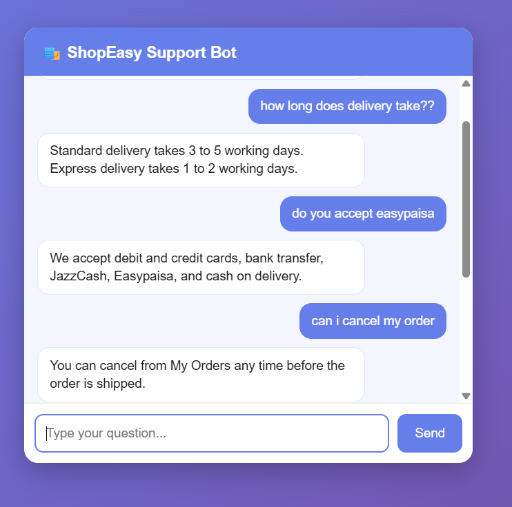

# 🛍️ FAQ Chatbot

A FAQ chatbot built with **Python and Django** as part of my **CodeAlpha Artificial Intelligence Internship (Task 2)**.

The bot answers customer questions for a fictional online store, "ShopEasy". It finds the most similar FAQ to the user's question using NLP and cosine similarity.

## Screenshot



## Features

- Chat interface with instant replies (no page reload)
- Understands differently worded questions, e.g. "how long is delivery" and "How long does delivery take?"
- Fallback reply when no FAQ is close enough
- Easy to extend: just add more entries to `faq_app/faqs.py`

## Tech Stack

- Python, Django
- NLTK (tokenization, stopword removal, stemming)
- scikit-learn (TF-IDF and cosine similarity)
- HTML, CSS, JavaScript

## How It Works

1. FAQ questions are cleaned with NLTK: lowercase, tokenize, remove stopwords, stem.
2. They are converted into TF-IDF vectors once, when the server starts.
3. The user's question goes through the same cleaning and is converted to a vector.
4. Cosine similarity is calculated against every FAQ question.
5. The answer of the best match is returned. If the best score is below 0.25, a fallback message is shown.

## How to Run

1. Clone the repository
```bash
   git clone https://github.com/aliahmedsani2004-prog/CodeAlpha_FAQChatbot.git
   cd CodeAlpha_FAQChatbot
```

2. Create and activate a virtual environment
```bash
   python -m venv venv
   venv\Scripts\activate
```
   (On Mac/Linux: `source venv/bin/activate`)

3. Install dependencies
```bash
   pip install -r requirements.txt
```

4. Download the NLTK stopwords
```bash
   python -c "import nltk; nltk.download('stopwords', download_dir='nltk_data')"
```

5. Start the server
```bash
   python manage.py runserver
```

6. Open `http://127.0.0.1:8000/` in your browser

## Limitations

The bot matches keywords, not meaning. A question that shares words with the wrong FAQ can get a wrong answer, and questions outside the FAQ list get the fallback reply.

## Author

**Ali Sani**
CS Student, Bahria University Karachi

Built for the CodeAlpha AI Internship.